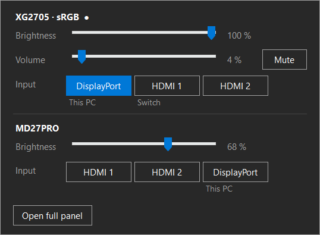
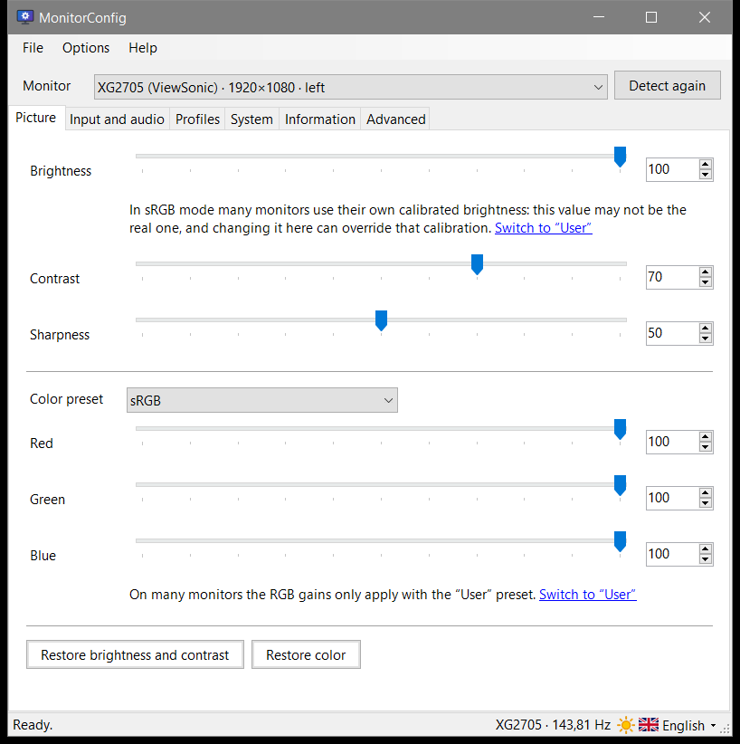
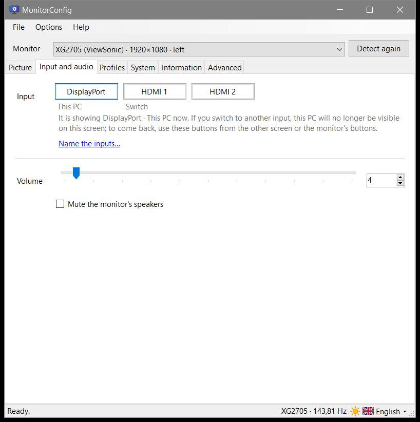
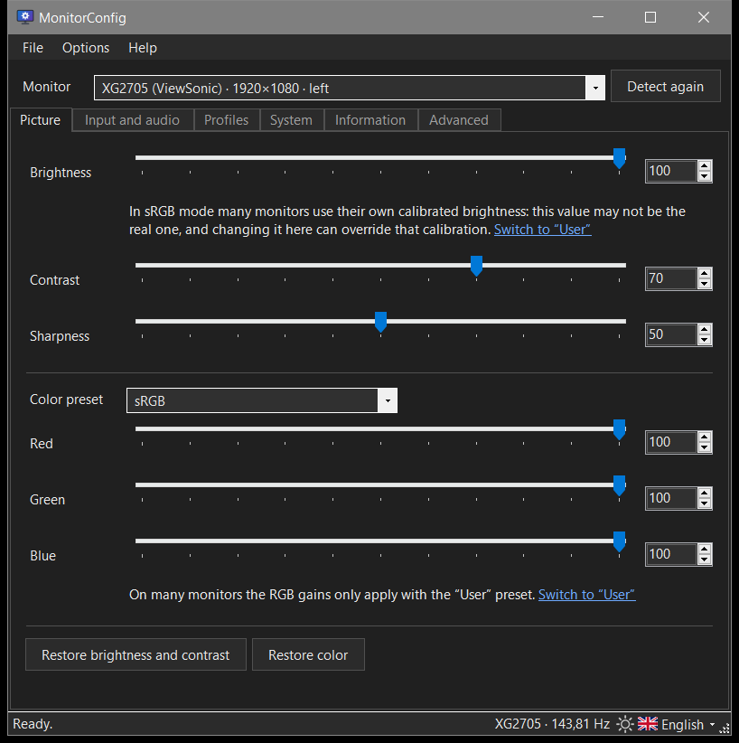
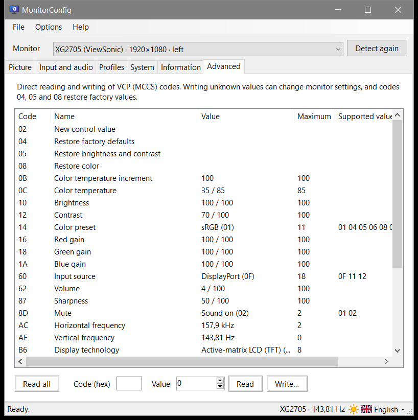
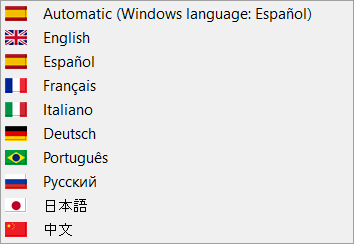

# MonitorConfig

[](https://github.com/JorgeGuzz/MonitorConfig/actions/workflows/build.yml)

A small portable Windows app for controlling monitors over **DDC/CI** from the system tray: brightness, contrast, color, input source, volume and any raw VCP code. It can also take commands from scripts.

It is a single executable of about 230 KB, with no installer and no runtime to install. It runs on the .NET Framework 4.8 that comes with Windows 10 and 11.

<p align="center">
  
</p>

| Picture | Input and audio |
|---|---|
|  |  |

| Dark mode | Advanced (raw VCP codes) |
|---|---|
|  |  |

<p align="center">
  
</p>

## Features

- **Tray panel.** Left-click the tray icon to set brightness, volume and input for each monitor. Right-click it for a menu with the same controls plus your profiles.
- **Full window**, with one tab per area:
  - **Picture:** brightness, contrast, sharpness, color preset and RGB gains.
  - **Input and audio:** input source, volume and mute.
  - **Profiles:** saved sets of values for each monitor.
  - **System:** the language of the monitor's own menu, turning that menu on or off, turning the screen off, and factory reset.
  - **Information:** model, serial number, video mode, firmware and the capabilities string.
  - **Advanced:** a table to read and write any VCP code directly.
- **Command line.** For scripts, shortcuts or a Stream Deck: `MonitorConfig.exe --brightness +10`. See [Command line](#command-line).
- **Knows which input is this PC.** It matches the cable type reported by Windows with the monitor's inputs and labels that input *This PC*. You can name the other inputs yourself, for example *Switch* or *Laptop*.
- **Keeps the chosen input.** When a source is still waking up, some monitors decide there is no signal and jump back to another input. MonitorConfig notices and requests the chosen input again, up to two times.
- **Warns about sRGB.** In their sRGB preset, many monitors use a fixed, calibrated brightness and ignore the brightness setting, which still reads back its old value. The app flags this, both in the window and in the tray panel.
- **Settings follow each physical monitor.** Monitors are identified by their EDID model and serial number, or by their Windows device instance when the serial is filler, so they no longer depend on the order Windows detects them in. Settings stay with the right monitor even after a reboot shuffles the order.
- **Changes survive power cycles.** After you stop changing a value, the app saves it to the monitor's own memory (the MCCS *Save Current Settings* command).
- **9 languages:** English, Spanish, French, Italian, German, Portuguese (Brazil), Russian, Japanese and Chinese (Simplified). The app starts in the Windows display language. You can switch any time from the flag button at the bottom of the window.
- **Light or dark.** The windows start in the Windows app mode; the sun button at the bottom of the window switches between light and dark. The tray panel and menu follow the Windows mode, as the taskbar does.
- **Update notice.** Once a day the app asks GitHub for the latest release and shows a notice when there is a new one. The request carries nothing but the app's version, and the check can be turned off in Settings.
- **Just the exe.** Settings are kept in `%APPDATA%\MonitorConfig\MonitorConfig.ini`, so the exe can live anywhere, even on the desktop. For a portable copy that carries its settings (on a USB stick, say), put a `MonitorConfig.ini` next to the exe: an empty file is enough, and it is used instead. Starting with Windows is optional.
- **Light on resources.** It uses no CPU while idle, and a single background thread handles all DDC traffic.

## Requirements

- Windows 10 or 11.
- A monitor with **DDC/CI turned on** in its own on-screen menu. Laptop built-in screens don't support DDC/CI, and some docks, adapters and KVM switches don't pass it through.

## Download

Get `MonitorConfig.exe` from the [Releases](../../releases) page and run it from any folder.

The exe is not code-signed, so Windows SmartScreen may warn the first time you run it. Choose **More info → Run anyway**.

## Command line

```text
MonitorConfig [--monitor <which>] <changes>

  --brightness <n|+n|-n>   brightness in %, or a change of n points
  --contrast <n|+n|-n>     contrast in %
  --volume <n|+n|-n>       speaker volume in %
  --mute <on|off|toggle>   speaker mute
  --input <name>           input: DisplayPort, HDMI1, HDMI2, USB-C... or a name you gave it
  --set <code>=<value>     any VCP code (hex) to a raw value, e.g. --set 10=50
  --profile <name>         applies a saved profile
  --monitor <which>        model (XG2705), position from the left (1, 2) or key; default: all
  --list                   monitors, their values and profiles
```

Some examples:

```bat
MonitorConfig.exe --brightness 30
MonitorConfig.exe --monitor 1 --brightness -10
MonitorConfig.exe --monitor XG2705 --input hdmi1
MonitorConfig.exe --profile Night
```

If MonitorConfig is already running, the command is handed to it over a named pipe that only your Windows user can open. That way every DDC request goes through the same queue, and the open windows stay in sync. If it is not running, the command does the change itself, stores it in the monitor, and exits.

The exit code is 0 when the change was made, 1 when no monitor could make it, and 2 when the command line is wrong. Windows does not wait for a windowed program, so use `start /wait MonitorConfig.exe ...` in a batch file when you need the exit code.

## Building from source

No SDK or Visual Studio is needed. The build uses the C# compiler that ships with the .NET Framework (`csc.exe`, C# 5):

```bat
build.cmd
```

The build produces two files:

- `MonitorConfig.exe`: the app.
- `tools\MonitorConfig.dev.exe`: a developer build that adds `--shots <dir>` (renders every window to PNG) and `--bench <file>` (measures resource use).

To run the tests:

```bat
test.cmd --no-ddc
```

The console tests cover:

- parsing, monitor identity and settings;
- the services, run against simulated monitors;
- the command line, including a round trip through the pipe;
- the completeness of every translation.

Without `--no-ddc`, the tests also read a ViewSonic XG2705 over DDC/CI and write back the brightness it already had, which leaves the monitor unchanged.

GitHub Actions runs the tests and the build on every push. For each published release, it attaches an `.exe` built from that release's source.

## How it works

DDC/CI is a side channel (I²C) inside the video cable. Windows exposes it through the Monitor Configuration API in `dxva2.dll`, and the settings themselves are numbered *VCP codes* defined by the VESA MCCS standard: `0x10` is brightness, `0x60` is the input source, and so on.

Monitors answer slowly (tens of milliseconds per request) and sometimes drop replies. For that reason:

- All DDC traffic goes through **one queue on one thread**, with retries.
- Repeated writes from a slider being dragged are **coalesced**, so only the latest value is sent.
- Saving to the monitor's memory is **debounced**, so it happens once you stop changing a value.

The hardware sits behind small interfaces (`IMonitorPort`, `IMonitorBus`), which lets the services be tested against fake monitors.

```text
src/Model      VCP codes, capabilities parser, monitor identity, settings, profiles
src/Hardware   Win32 interop: dxva2, EDID from the registry, connection types (QueryDisplayConfig)
src/Services   DDC queue, monitor service, save scheduler, input watcher, profiles,
               command line (runner and pipe server), update check
src/UI         WinForms: tray app, tray panel, main window tabs, dialogs, dark mode, flags
src/Lang       translations (key=value), checked and compressed into the exe at build time
src/Dev        developer-only tools (compiled with DEVTOOLS)
tools          tests with fake monitors, translation packer, icon generator
```

### Limitations

- A monitor only reports its *current* input over DDC/CI. Whether the other inputs have a signal cannot be read.
- In dark mode, message boxes and the arrows of number boxes keep the system's light look: WinForms cannot recolour them.

## License

[MIT](LICENSE)
